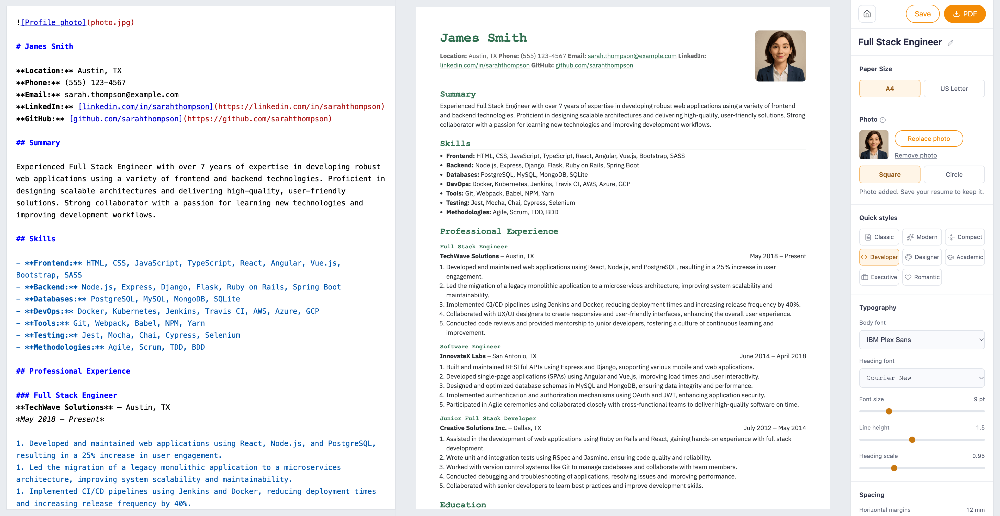

# Resumis

Build Markdown resumes with live preview and save them to your GitHub repository. Runs on Cloudflare Workers; no database required.

[](https://deploy.workers.cloudflare.com/?url=https://github.com/garylab/resumis)

## Features

- Eight templates and Quick styles, visual controls, and Advanced CSS.
- Photo upload with text wrapping, rounded-square or circle shapes.
- A4/US Letter layouts and browser PDF export.
- GitHub repository/branch selection, saving, renaming, duplication, and deletion.

Each resume lives in its own repository folder as `resume.md`, `style.css`, and an optional `photo.jpg`. Visual changes appear in Advanced CSS and are saved to `style.css`.

## Local setup

Requires Node.js 22+ and npm.

```sh
npm ci
cp -n .dev.vars.example .dev.vars
```

Edit `.dev.vars`, then run `npm run dev` and open **http://localhost:8988**. Register your GitHub OAuth callback as `http://localhost:8988/auth/callback`.

## Environment variables

All variables are listed in [`.dev.vars.example`](.dev.vars.example). **Required means required for GitHub sign-in and saving**; editing and PDF export work without credentials.

| Variable | Required? | Type | Description |
| --- | --- | --- | --- |
| `GITHUB_CLIENT_ID` | Yes | Text | GitHub OAuth app client ID |
| `GITHUB_CLIENT_SECRET` | Yes | Secret | GitHub OAuth app client secret |
| `SESSION_SECRET` | Yes | Secret | Random secret, at least 32 characters; generate with `openssl rand -hex 32` |
| `SITE_NAME` | No | Text | Site name; defaults to `Resumis` |
| `PUBLIC_ORIGIN` | No | Text | HTTPS proxy origin, e.g. `https://dev.resumis.com` |
| `GA_MEASUREMENT_ID` | No | Text | Google Analytics ID; blank disables analytics |
| `PRIVACY_POLICY_CONTENT` | No | Text | Privacy policy Markdown; blank keeps the default page |
| `TERMS_OF_SERVICE_CONTENT` | No | Text | Terms of service Markdown; blank keeps the default page |
| `FOOTER_CONTENT` | No | Text | Additional footer Markdown |

For multiline Markdown, use double-quoted `\n` escapes, e.g. `FOOTER_CONTENT="[Privacy](/privacy-policy)\n\nMade with Resumis"`. With an HTTPS proxy, set `PUBLIC_ORIGIN` and use that same origin for sign-in and the `/auth/callback` URL.

## Deploy

Use the Cloudflare button above, or run:

```sh
npx wrangler login
npm run deploy
```

Configure production values in your Worker's **Settings → Variables and Secrets**, using the types above. `.dev.vars` is local only. Set the OAuth callback to `https://<your-host>/auth/callback`. For Git builds, use the repository root and deploy command `npm run deploy`.

Keep `keep_vars: true` and leave `vars` out of Wrangler configuration to preserve dashboard settings.

## Development

```sh
npm test                         # Build and unit tests
npm run check                    # Deployment dry run
npx playwright install chromium
npm run test:browser              # Browser tests with mocked GitHub
```

Edit `templates/`, `public/static/`, and `styles/` for the UI; `data/resumes/` for built-in resumes. The build generates Tailwind CSS, Lucide icons, and local font assets. Health endpoint: `/health`.
